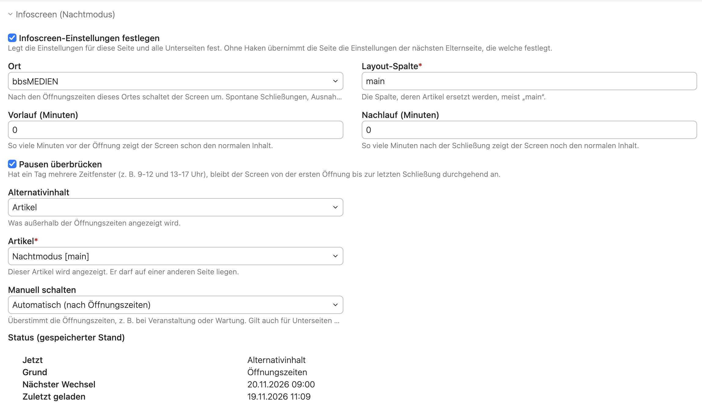

# nightmode_contao

*** Release Candidate: im Einsatz getestet, aber noch nicht als stabil gekennzeichnet ***

Nachtmodus für Infomonitore in Contao (Bundle für Contao 5.7 oder neuer, PHP 8.5): Eine Seite zeigt ihre Artikel
nur während der Öffnungszeiten. Außerhalb davon erscheint ein Alternativinhalt. Die Artikel selbst bleiben
unverändert, entschieden wird bei jedem Aufruf der Seite. Ein Cronjob ist nicht nötig.

Die Öffnungszeiten kommen aus [opentimes_contao](https://github.com/derkosmonaut/opentimes_contao), das automatisch
mitinstalliert wird. Spontane Schließungen, Ausnahmen, Feiertage und Saisonzeiten gelten damit auch für die Screens.



## Funktionsumfang

- Ein Screen ist eine Contao-Seite mit eigener URL
- Einstellungen werden im Seitenbaum vererbt: Eine Elternseite (z. B. „Kassenbereich“) bildet einen Raum, alle
  Unterseiten übernehmen ihre Einstellungen
- Alternativinhalt: schwarzer Screen, ein Artikel (auch von einer anderen Seite) oder der Inhalt einer anderen Seite
- Vorlauf und Nachlauf in Minuten
- Pausen überbrücken bei mehreren Zeitfenstern am Tag
- Manuell schalten, z. B. für Veranstaltungen oder Wartung
- Statusanzeige mit nächstem Wechsel und „Zuletzt geladen“ pro Screen

## Installation

Im Contao Manager nach `derkosmonaut/nightmode-contao` suchen und installieren. `opentimes-contao` kommt automatisch
mit. Danach die Datenbank aktualisieren und einmal den Cache leeren.

## Anleitung

**1. Ort anlegen.** Unter „Inhalte → Öffnungszeiten“ einen Ort mit Zeitplan anlegen (siehe opentimes_contao). Für
Screens, die sich nicht nach Publikumszeiten richten, z. B. im Personalraum, einfach einen eigenen Ort anlegen.

**2. Seitenstruktur anlegen.** Pro Raum eine Elternseite, darunter eine Seite je Monitor:

```
Infoscreens
└── Kassenbereich        ← hier die Einstellungen festlegen
    ├── kasse-links      ← übernimmt alles
    └── kasse-rechts     ← übernimmt alles
```

Jeder Monitor ruft die URL seiner eigenen Seite auf.

**3. Einstellungen festlegen.** In den Seiteneinstellungen von „Kassenbereich“ im Bereich „Infoscreen (Nachtmodus)“
den Haken bei „Infoscreen-Einstellungen festlegen“ setzen und ausfüllen:

| Feld | Bedeutung |
|---|---|
| Ort | Nach dessen Öffnungszeiten wird umgeschaltet |
| Layout-Spalte | Die Spalte, deren Artikel ersetzt werden, meist `main` |
| Vorlauf / Nachlauf | Minuten vor der Öffnung schon an, nach der Schließung noch an |
| Pausen überbrücken | Bei 9–12 und 13–17 Uhr durchgehend von 9 bis 17 Uhr an |
| Alternativinhalt | Schwarzer Screen, ein Artikel oder der Inhalt einer anderen Seite |

Die Unterseiten brauchen keinen Haken, sie übernehmen die Einstellungen. Setzt eine Unterseite selbst den Haken,
gelten für sie (und ihre Unterseiten) ihre eigenen Einstellungen.

**4. Automatisches Neuladen.** Die Monitore müssen die Seite regelmäßig neu laden, damit sie umschalten, z. B. im
Seitenlayout unter „Eigener Code“ im Kopfbereich:

```html
<meta http-equiv="refresh" content="90">
```

Infoscreen-Seiten werden nie gecacht. Änderungen sind daher spätestens nach dem nächsten Neuladen sichtbar.

**5. Manuell schalten.** Für Ausnahmen, die nicht ins Öffnungszeiten-Modul gehören:

- **Automatisch (nach Öffnungszeiten)**: Standard
- **Immer normalen Inhalt zeigen**: z. B. bei einer Abendveranstaltung
- **Immer Alternativinhalt zeigen**: z. B. bei Wartung

An „Kassenbereich“ eingestellt, gilt es für alle Unterseiten, die auf „Automatisch“ stehen. Danach wieder auf
„Automatisch“ zurückstellen.

**6. Status prüfen.** Unten im Bereich steht, was der Screen gerade zeigt, warum, wann er das nächste Mal wechselt und
wann er zuletzt geladen wurde. Liegt „Zuletzt geladen“ deutlich länger zurück als das Reload-Intervall, hängt der
Monitor vermutlich.

## Regeln

1. Manuell schalten schlägt alles
2. Kein Ort gewählt oder der Ort hat keinen Zeitplan → normaler Inhalt (lieber Inhalt als ein dunkler Screen)
3. Sonst nach Öffnungszeiten, erweitert um Vor- und Nachlauf. Ohne „Pausen überbrücken“ schaltet der Screen in
   Pausen um, außer die Pause ist kürzer als Vor- plus Nachlauf.

Ist der gewählte Alternativinhalt leer (gelöscht, unveröffentlicht), zeigt der Screen schwarz.

## Hinweise

- Der schwarze Screen legt eine Fläche über die ganze Seite. Kopf- und Fußbereich des Layouts werden darunter
  weiter geladen, sind aber nicht sichtbar.
- Ein Video als Alternativinhalt startet bei jedem Neuladen von vorn. Für solche Screens das Intervall länger setzen.
- Gebaut für das klassische Seitenlayout. Ob die Umschaltung auch mit den Twig-Layouts von Contao 5.7 greift,
  ist noch nicht geprüft.

## Technik

- `Screen\ScreenStateResolver`: reine Logik, mit Tests abgedeckt
- `Schedule\ScheduleProviderInterface`: Quelle der Öffnungszeiten, umgesetzt von `Integration\OpenTimes\OpenTimesScheduleProvider`
- `EventListener\GetArticlesListener`: ersetzt die Artikel der Spalte
- `EventListener\ScreenResponseListener`: kein Cache, „Zuletzt geladen“

## Lizenz

GPL-3.0-or-later
